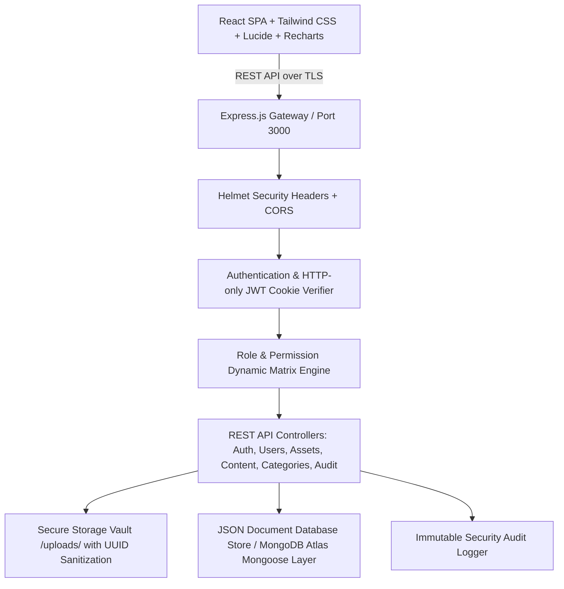

# Digital Asset & Content Management System (CMS) with RBAC
## Final-Year B.E. Computer Science & Engineering (Cyber Security) Academic Project

### 1. Abstract
The Digital Asset & Content Management System (CMS) with Role-Based Access Control (RBAC) provides an enterprise-grade, zero-trust platform for cataloging, securing, moderating, and distributing digital assets (documents, images, research papers, diagrams, audio/video media) and academic/institutional publications. Engineered specifically around cybersecurity principles, the system enforces server-side nonces, cryptographic token validation via HTTP-only JWT cookies, strictly bounded resource ownership checks to mitigate Broken Object Level Authorization (BOLA), sanitized file ingestion pipelines immune to path traversal and web shells, and an immutable security audit logging stream for forensics and non-repudiation.

### 2. System Architecture

### 3. Layer Breakdown
1. **Presentation Layer (Frontend)**:
   - React 19 SPA running on Vite.
   - Distinct Admin and User workspaces.
   - Real-time notification polling, asset preview modals (PDFs, images, code/data, audio), drag-and-drop uploads, and dynamic analytical dashboards.
2. **Security & Gateway Tier**:
   - HTTP-only cookie-based authentication preventing client-side Cross-Site Scripting (XSS) credential theft.
   - CSRF & CORS origin isolation.
   - Request body size limits and MIME signature enforcement.
3. **Authorization Tier (RBAC Engine)**:
   - Dynamic role-permission mapping loaded from database.
   - Resource-level ownership guards (`isOwner || hasPermission('asset:edit_all')`).
   - Anti-escalation rules (protection preventing removal/deactivation of the final active administrator).
4. **Data & Storage Tier**:
   - UUID file keying preventing directory traversal and file overwrites.
   - Mongoose schemas with indexed querying, relationships, and soft-deletion lifecycle.
