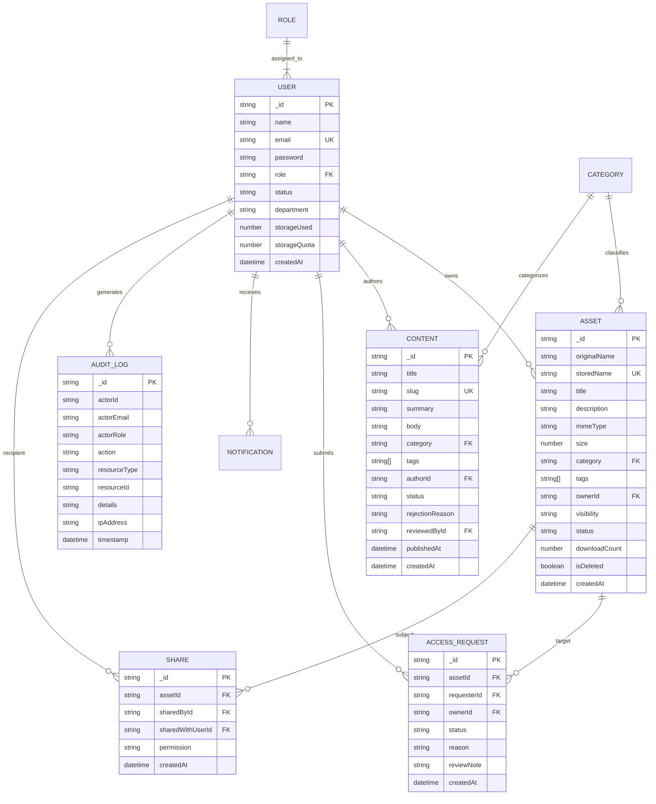

# Database Design & Entity Relationship Model

### 1. Entity-Relationship Diagram (ERD)

### 2. Indexes & Performance Optimizations
- `User.email`: Unique index for $O(1)$ authentication lookups.
- `Asset.ownerId` + `Asset.createdAt`: Compound index for rapid personal repository queries.
- `Asset.category`: Index for rapid taxonomic filtering.
- `Content.slug`: Unique index for SEO and direct URL resolution.
- `AuditLog.timestamp`: Descending index for rapid security telemetry feeds.
